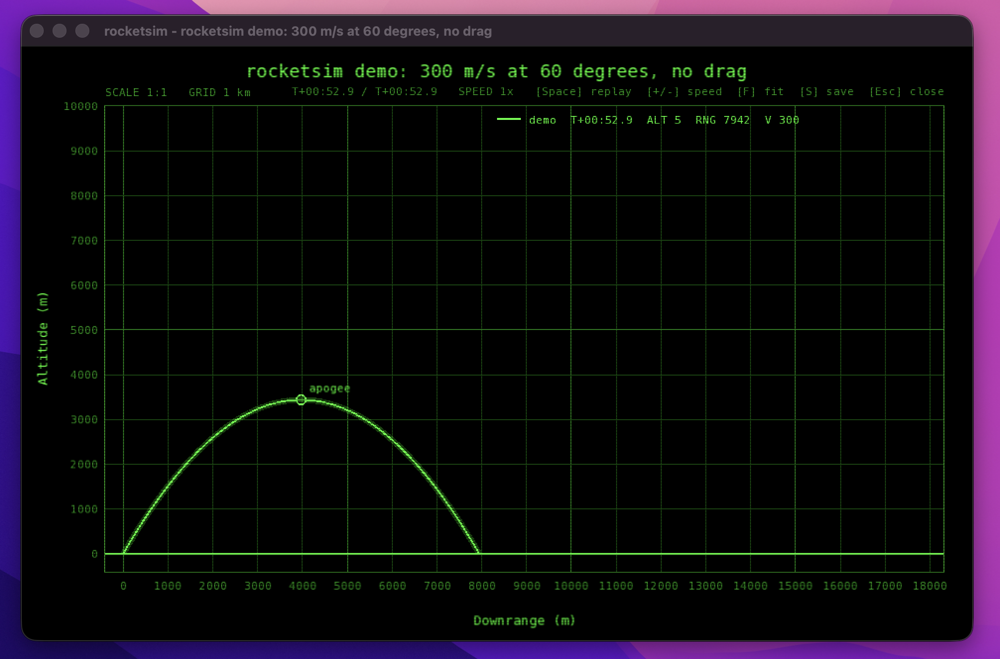
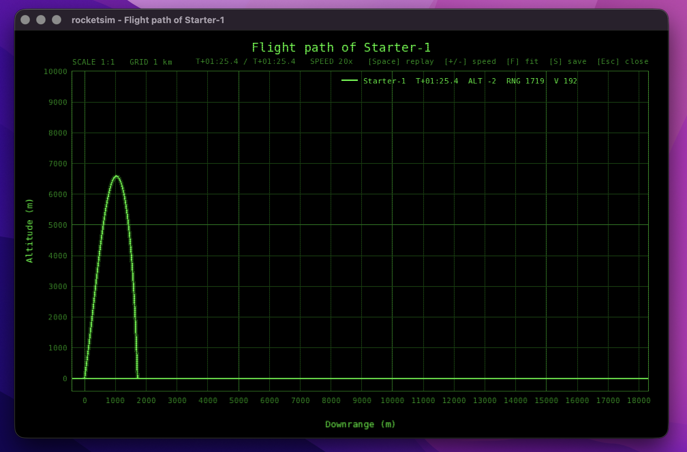
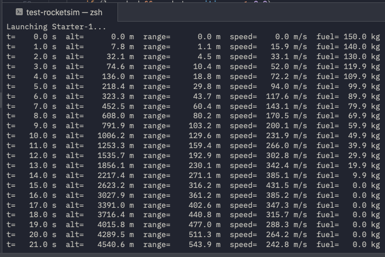
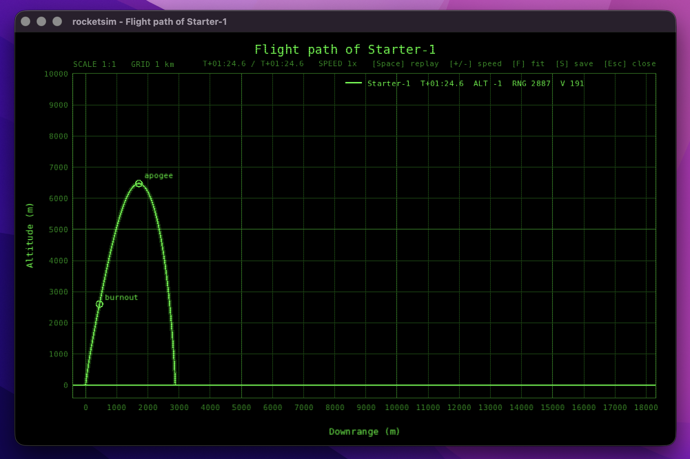
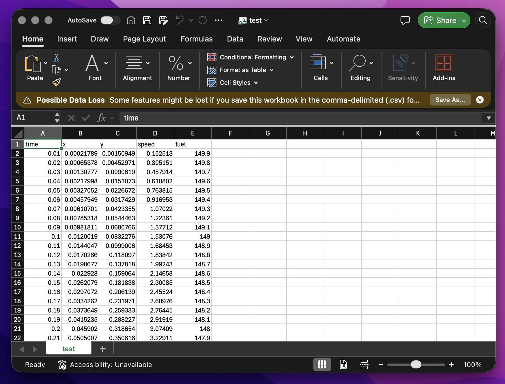

# Week 7 — Getting the Rocket to Fly!

### References, strings, streams, `new` / `delete`

| | |
| --- | --- |
| **Lecture material** | Pass by `const&` and `&` · `cout` / `<iomanip>` · `std::string` · overloading and default arguments· `const` and `constexpr` · `new[]` / `delete[]` · headers and the two-file model |
| **Starting point** | The `rocketsim/` starter folder |
| **Files you will edit** | `physics.cpp`, `physics.h`, `simulation.cpp`, `main.cpp`, `config.cpp`; new `telemetry.h` / `telemetry.cpp` (Hard) |
| **Reference pages** | [physics](../code-reference/physics.md) · [simulation](../code-reference/simulation.md) · [vec2](../code-reference/vec2.md) · [config](../code-reference/config.md) |

---

## By the end of this lab

- The rocket **flies**: the stationary dot in the starter code becomes a full arc from the launch pad to a landing.
- The console prints a neatly aligned **telemetry table** and a **flight summary**.
- *(Medium)* The flight performs a **gravity turn** and the plot marks **burnout** and **apogee**.
- *(Hard)* The rocket can be loaded from a **launch file**, and every step is recorded in a hand-built **dynamic array** written out as a CSV.

---

## Background

### The problem

You have a working program that does nothing interesting yet. 

It parses its command line, builds a rocket, runs a loop, and plots the result but the rocket never moves, because every physics function is a currently a stub (a small, short piece of code that acts as a temporary placeholder for a method, function, or routine that has not been fully written yet). This week your task is to write the physics that makes the rocket fly.

This week you are tasked to write the code the way you would have in C (i.e., plain functions acting on a struct) but with the C++ tools from this week's lectures. The difference to look for is **how data gets into and out of functions**.

### Pointers vs references

In C, a function that needs to read a large struct without copying it, or needs to change it, takes a pointer:

```c
/* C: lecture 4 style */
double area(const Shape* s) { return s->width * s->height; }
void   grow(Shape* s, double k) { s->width *= k; }
```

In C++ the same intent is written with **references**:

```cpp
// C++
double area(const Shape& s) { return s.width * s.height; }
void   grow(Shape& s, double k) { s.width *= k; }
```

A reference cannot be null, cannot be re-seated to point at something else, and needs no `->` or `&` at the call. A `const&` additionally makes the compiler **refuse** any attempt to change the object.

Look at `physics.h`: every function that only *reads* the rocket takes `const Rocket&`. Exactly one takes a plain `Rocket&`. Before you write anything, work out which one and why.

### The physics model

You do not need any physics beyond this section. The rocket is treated as a single point with a mass. `x` is the distance downrange and `y` is the altitude, both in metres, with the launch pad at the origin and the ground at `y = 0`.

#### Symbols

**Bold** symbols are **vectors** with an x and a y component (a `Vec2` in the code). Plain symbols are single numbers (**scalars**, a `double` in the code).

| Symbol | Meaning | Unit | Where it is in the code |
| --- | --- | --- | --- |
| $m$ | Current total mass of the rocket | kg | `totalMass(rocket)` |
| $m_{dry}$ | Dry mass: structure and payload, never changes | kg | `rocket.dryMass` |
| $m_{fuel}$ | Fuel still on board | kg | `rocket.fuelMass` |
| $g$ | Acceleration due to gravity, $9.81$ | m/s² | `physics::GRAVITY` |
| $T$ | Engine thrust (the size of the force) | N | `rocket.thrust` |
| $\dot{m}$ | Burn rate: fuel used per second while the engine runs | kg/s | `rocket.burnRate` |
| $\hat{\mathbf{d}}$ | Thrust direction, a **unit vector** (length 1) | — | `unitFromAngle(rocket.launchAngleDeg)` |
| $\mathbf{p}$ | Position $(x, y)$ | m | `rocket.position` |
| $y$ | Altitude, the y component of $\mathbf{p}$ | m | `rocket.position.y` |
| $\mathbf{v}$ | Velocity | m/s | `rocket.velocity` |
| $\lvert\mathbf{v}\rvert$ | Speed: the length of $\mathbf{v}$ | m/s | `length(rocket.velocity)` |
| $\mathbf{a}$ | Acceleration | m/s² | a local variable in `step` |
| $\rho(y)$ | Air density at altitude $y$ | kg/m³ | `airDensity(y)` |
| $\rho_0$ | Air density at sea level, $1.225$ | kg/m³ | `physics::SEA_LEVEL_DENSITY` |
| $H$ | Scale height of the atmosphere, $8500$ | m | `physics::SCALE_HEIGHT` |
| $C_d$ | Drag coefficient (no unit) | — | `rocket.dragCoeff` |
| $A$ | Frontal area of the rocket | m² | `rocket.area` |
| $\mathbf{F}_g$, $\mathbf{F}_t$, $\mathbf{F}_d$ | Gravity, thrust and drag forces | N | `gravityForce`, `thrustForce`, `dragForce` |
| $t$ | Mission time | s | `rocket.time` |
| $\Delta t$ | Time step: how far time moves in one call to `step` | s | `dt` |
| $e$ | Euler's number, $\approx 2.718$; $e^{x}$ is written `std::exp(x)` | — | `std::exp` |

Every multiplication is written with $\times$. A **scalar $\times$ vector** multiplies each component by the scalar: for example, $3 \times (1, 2) = (3, 6)$. In the code that is `scale(v, k)`.

#### Mass

$$
m = m_{dry} + m_{fuel}
$$

#### The three forces

**Gravity** always points straight down (negative y):

$$
\mathbf{F}_g = \bigl(0,\; -\,m \times g\bigr)
$$

**Thrust** has size $T$ and points along $\hat{\mathbf{d}}$, but only while there is fuel left:

$$
\mathbf{F}_t =
\begin{cases}
T \times \hat{\mathbf{d}} & \text{if } m_{fuel} > 0 \\[4pt]
(0,\; 0) & \text{otherwise}
\end{cases}
$$

**Drag** always points **opposite** to the velocity, and grows with the square of the speed:

$$
\mathbf{F}_d = -\,\tfrac{1}{2} \times \rho(y) \times C_d \times A \times \lvert\mathbf{v}\rvert \times \mathbf{v}
$$

It can help to read this as a size times a direction. The size of the drag force is $\tfrac{1}{2} \times \rho(y) \times C_d \times A \times \lvert\mathbf{v}\rvert^2$. The direction is $-\,\mathbf{v} \div \lvert\mathbf{v}\rvert$, a unit vector pointing backwards along the flight path.

**Air density** falls off exponentially with altitude:

$$
\rho(y) = \rho_0 \times e^{-\,y \,\div\, H}
$$

#### One time step (Euler's method)

Each call to `step(rocket, dt)` moves the rocket forward by $\Delta t$ seconds. The calculations are done **in this order**, and each line uses the values produced by the lines above it. The subscript "new" marks the value stored back into the rocket.

$$
\begin{aligned}
&\text{1. Total force:} && \mathbf{F} = \mathbf{F}_g + \mathbf{F}_t + \mathbf{F}_d \\[4pt]
&\text{2. Acceleration:} && \mathbf{a} = \mathbf{F} \div m \\[4pt]
&\text{3. Velocity:} && \mathbf{v}_{new} = \mathbf{v} + \mathbf{a} \times \Delta t \\[4pt]
&\text{4. Position:} && \mathbf{p}_{new} = \mathbf{p} + \mathbf{v}_{new} \times \Delta t \\[4pt]
&\text{5. Fuel (only while the engine runs):} && m_{fuel,\,new} = \max\bigl(0,\; m_{fuel} - \dot{m} \times \Delta t\bigr) \\[4pt]
&\text{6. Time:} && t_{new} = t + \Delta t
\end{aligned}
$$

Dividing a vector by a scalar, as in step 2, divides each component, which is the same as $\mathbf{F} \times (1 \div m)$. Step 4 uses the **new** velocity from step 3. The $\max(0,\;\ldots)$ in step 5 stops the fuel going negative on the last burning step.

#### The default rocket

| Quantity | Value |
| --- | --- |
| Lift-off mass $m$ | $50 + 150 = 200$ kg |
| Thrust $T$ | $5000$ N |
| Burn time | $m_{fuel} \div \dot{m} = 150 \div 10 = 15$ s |
| Launch angle | $85^\circ$ from horizontal |
| Time step $\Delta t$ | $0.01$ s |

---

## Before you start

1. Unzip the `rocketsim` folder and configure it **straight away** — the first `cmake -B build` downloads SFML and takes a few minutes.
   ```sh
   cd rocketsim
   cmake -B build
   cmake --build build
   ```
2. Run `./build/rocketsim --demo`. A window replays a parabola in real time. Press **+** to speed it up, **Space** to restart, **Esc** to close. Note the **1 km grid** — it is the same on every run, so compare flights against the grid, not the window edges.
3. Run `./build/rocketsim` on its own and confirm it prints **`The rocket never left the pad`**.
4. Read `vec2.h` and `physics.h` **in full**. They are short, and you will use every function in them.



> [!NOTE]
> Can't build with the window? Use `cmake -B build -DROCKETSIM_LIVE=OFF` and open `flight.svg` in a web browser instead. Every task works this way.

### Running with command-line arguments in CLion

`rocketsim` is controlled by command-line arguments such as `--demo`, `--quiet`, `--launch launch.txt` and `--out test`. In a terminal you type them after the program name. In CLion you set them once in a **run configuration**, and the **Run** button passes them every time.

1. Open the folder in CLion (**File → Open…** and choose the `rocketsim` folder). CLion detects `CMakeLists.txt` and configures the project; the first configure downloads SFML, so wait for the CMake tool window to finish.
2. In the toolbar at the top right, make sure the run configuration drop-down shows **rocketsim**.
3. Open the drop-down and choose **Edit Configurations…** (or use the menu **Run → Edit Configurations…**).
4. Select **rocketsim** under **CMake Application** on the left.
5. Fill in two fields:

   | Field | What to enter | Why |
   | --- | --- | --- |
   | **Program arguments** | The arguments only, without the program name, e.g. `--demo` or `--launch launch.txt --out test` | CLion passes these to `main` as `argv[1]`, `argv[2]`, … |
   | **Working directory** | `$ProjectFileDir$` (click the folder icon or type it) | Relative paths are resolved from here, so `launch.txt` is found in the project folder and `flight.svg` is written there too |

6. Click **OK**, then press **Run** (the green triangle, or **Ctrl+R** on macOS / **Shift+F10** on Windows and Linux).


> [!TIP]
> **Keep one configuration per command.** In the **Edit Configurations…** dialog, select **rocketsim** and click **Copy Configuration** (the copy icon), then give each copy a clear name with its own arguments, for example:
>
> | Configuration name | Program arguments |
> | --- | --- |
> | `rocketsim` | *(empty)* |
> | `rocketsim demo` | `--demo` |
> | `rocketsim launch file` | `--launch launch.txt --out test` |
>
> Switching between them is then a single click in the toolbar drop-down.

> [!WARNING]
> - A launch file that **cannot be opened**, or output files that seem to vanish, almost always mean the **working directory** is not set. CLion's default is the build folder (e.g. `cmake-build-debug`), so `launch.txt` is not found there and `flight.svg` is written there instead.
> - Arguments are split on spaces. If a file name contains a space, put it in double quotes: `--launch "my rocket.txt"`.
> - The **Run** tool window at the bottom of CLion is where the telemetry table and summary appear. The live window opens separately; close it (**Esc**) to let the program finish.

---

## Easy — make it fly

### Task E1 · Mass, gravity and thrust

In `physics.cpp`, implement `totalMass`, `engineRunning`, `gravityForce` and `thrustForce`.

- Thrust acts along `unitFromAngle(rocket.launchAngleDeg)` while fuel remains.
- Use the `Vec2` helpers in `vec2.h` (`add`, `scale`, …).
- **Do not write `->` anywhere.**

Build and run. With no drag and no `step` yet nothing will move — that comes next. Make sure it compiles cleanly with no warnings.

**Done when:** the four functions compile, and each one does exactly what its comment in `physics.h` says.

---

### Task E2 · Drag and the time step

Implement `dragForce` using `airDensity` and the drag formula above. It must point **against** the velocity.

Then implement `step` using Euler's method, in the order given in its comment.

> [!TIP]
> Try implementing `step` *before* `dragForce` (leave drag returning zero). Gravity will eventually win and the rocket will come down — check the summary to see how high it got. Then add drag and watch the apogee drop.

**Done when:** the rocket flies an arc and lands. The summary's flight time and range are no longer zero.



---

### Task E3 · A telemetry table

In `simulate`, print one telemetry line every `settings.printEvery` seconds. Use `std::cout` with `std::fixed`, `std::setprecision(1)` and `std::setw` so the columns line up:

```text
t=  12.00 s  alt=  1234.5 m  range=   56.7 m  speed=  123.4 m/s  fuel=  30.0 kg
```

`printStats` at the bottom of the same file is a worked example of the formatting.

**Compare with C:** in lecture 5 you would have written `printf("%8.1f", …)`. The output is the same, but with `<<` the **compiler checks the types**. Try passing a `std::string` to `%f` in `printf` and to `<<` in C++, and compare what happens.

**Done when:** a table of aligned columns scrolls past during the flight, one row per second.



---

### Task E4 · `const` everywhere

1. Mark every parameter and local variable that is never modified as `const`.
2. Then **deliberately** add `rocket.fuelMass = 0;` inside `gravityForce` and build.
3. Read the compiler error. Then remove the line.

This is what `const Rocket&` gives you over C's `Rocket*`. The compiler enforces that this function only reads.

**Done when:** you can explain the error message.

---

### Sanity checks for your physics

Use these to check your `step` and forces against known answers (default rocket, `dt = 0.01`).

| Check | How | Expected |
| --- | --- | --- |
| **Rocket equation** | Temporarily set `dragCoeff = 0` | Speed at burnout (t = 15 s) ≈ **547 m/s** |
| **Drag-free flight** | As above | Apogee ≈ **18,000 m** at t ≈ 70 s; range ≈ 7,370 m; flight time ≈ 131 s |
| **Week 7 Easy** | Defaults | Apogee ≈ **6,590 m** at **40.3 s**; max speed ≈ 432 m/s; range ≈ 1,720 m; flight time ≈ 85 s |

> [!NOTE]
> The first check has a closed-form answer, worked out in three steps:
> - **Exhaust velocity:** $v_e = T \div \dot{m} = 5000 \div 10 = 500$ m/s.
> - **Ideal speed gain** along the launch direction: $\Delta v = v_e \times \ln(200 \div 50) = 500 \times \ln 4 \approx 693$ m/s. Here $\ln$ is the natural logarithm (`std::log`).
> - **Gravity loss:** subtract $g \times 15\ \text{s} = 9.81 \times 15 \approx 147$ m/s from the **vertical** component.
>
> If your speed at burnout is within a few m/s of the expected value, your `step` is correct.

---

## Medium — flight statistics and a gravity turn

### Task M1 · Flight statistics and markers

Fill in the remaining `FlightStats` fields **inside the loop**:

| Field | Meaning |
| --- | --- |
| `apogee`, `apogeeTime` | The highest `position.y` seen, and when |
| `maxSpeed` | The highest speed (`length(velocity)`) seen |
| `burnoutTime` | The first step at which `engineRunning` becomes false |

Call `plot.addMarker` at burnout (during the loop) and at apogee (after the loop). Both labels must appear on the SVG.

**Done when:** the summary shows the Easy sanity-check numbers, and the plot shows `burnout` and `apogee` markers.

---

### Task M2 · The gravity turn

Real rockets do not hold a fixed angle all the way up. After clearing the pad they **pitch over** and let the thrust follow the direction of travel, so gravity gradually bends the path into an efficient arc.

1. Add `constexpr double PITCH_OVER_ALTITUDE = 300.0;` to `physics.h`.
2. Change `thrustForce` so that **above** that altitude, thrust points along `normalised(velocity)` instead of the launch angle.

**Done when:** the 85° launch bends into a proper arc and lands about **2,890 m** downrange instead of 1,720 m.



---

### Task M3 · Telemetry to any stream

Move the telemetry line into its own function in `simulation.cpp`:

```cpp
void printTelemetry(std::ostream& out, const Rocket& rocket);
```

Call it with `std::cout`. Then **remove the `&`** from `std::ostream&` and read the error.

Streams cannot be copied, so this only compiles when `out` is a reference. As a bonus, the same function can now write to a file stream as well as the console.

**Done when:** output is unchanged, and you can explain why the version without `&` fails.

---

### Task M4 · Overloading `report`

Write three functions with the **same name** and use them from `main`:

```cpp
void report(const Vec2& v);
void report(const Rocket& r);
void report(const FlightStats& s, int precision = 1);
```

One name, three parameter lists, one default argument. Call each from `main` (e.g. report the final position, the rocket, and the stats at two different precisions).

**Done when:** all three are called from `main` and the compiler picks the right one each time.

---

## Hard — a launch file and a hand-built log

### Task H1 · Reading a launch file

Implement `loadLaunchFile` in `config.cpp` using `std::ifstream`, `std::getline`, `find`, `substr` and `std::stod`.

- Strip `#` comments, skip blank lines, and trim spaces around keys and values.
- Report unknown keys on `std::cerr` **with the line number**.
- See the [launch file format](../code-reference/build-and-project.md#launchtxt) for every key.
- In CLion, set **Program arguments** to `--launch launch.txt` and **Working directory** to `$ProjectFileDir$` (see [Running with command-line arguments in CLion](#running-with-command-line-arguments-in-clion)).

**Done when:** `rocketsim --launch launch.txt` reproduces the default flight **exactly**, and changing `launch_angle` in the file changes the plot without rebuilding.

> [!WARNING]
> Try setting a value to `fifty`. `std::stod` **throws**, and the program dies. Leave it like that — Week 11 fixes it properly with exceptions.

---

### Task H2 · A hand-built telemetry log

Create `telemetry.h` / `telemetry.cpp` with a **C-style dynamic array**, written the way lecture 3 would, but with `new[]` / `delete[]` instead of `malloc` / `free`:

```cpp
struct Sample { double time, x, y, speed, fuel; };

struct TelemetryLog { Sample* samples; int size; int capacity; };

TelemetryLog createLog(int capacity);
void append(TelemetryLog& log, const Sample& s);
void destroyLog(TelemetryLog& log);
```

- `append` must **double the capacity** when the array is full: allocate a new array, copy across, `delete[]` the old one.
- Record every step in `simulate`.
- Write `telemetry.csv` with `std::ofstream` and open it in a spreadsheet.
- Call `destroyLog` before `main` returns.

> [!CAUTION]
> Do **not** copy a `TelemetryLog` by value anywhere. Think about what a copy of this struct contains. Next week shows exactly why that would crash.

**Done when:** `telemetry.csv` opens in a spreadsheet with one row per time step, and a chart of altitude against time matches your plot.



---

### Task H3 · An `--out` option

Add `--out NAME` so the SVG and CSV are written as `NAME.svg` and `NAME.csv`. Build the file names with `std::string` concatenation.

Each argument arrives in `main` as one element of `argv`, so `--out test` is two elements: `argv[i]` is `"--out"` and `argv[i + 1]` is `"test"`. Look at how `main` already handles `--launch FILE` for the pattern. To test it in CLion, add `--out test` to **Program arguments**.

**Done when:** `rocketsim --out test` writes `test.svg` and `test.csv`.

---

## Checkpoint

Before moving on, run your program and check each of the following yourself:

| Tier | Check that… |
| --- | --- |
| Easy | A telemetry table, a summary with **apogee ≈ 6,590 m at 40.3 s**, and `flight.svg` showing an arc from the pad to the landing point with the ground line under it |
| Medium | Apogee **≈ 6,475 m**, range **≈ 2,890 m**, with `burnout` and `apogee` markers on the plot |
| Hard | `rocketsim --launch launch.txt --out test` writes `test.svg` and `test.csv` |

---

## Watch out for

- **`step` must advance `rocket.time`.** If it does not, the loop stops after its step-count guard and prints the "never left the pad" hint.
- **Burn the fuel after computing the forces**, not before, or the first step runs with the wrong mass.
- **`std::fixed` is sticky.** Once set on `cout` it stays set — which is why `printStats` sets it again.
- **Resist `printf`.** It still works in C++, but the point of this week is that `<<` is type-checked. Habits formed now matter in Week 11, when `<<` and `>>` are the whole point.

---
