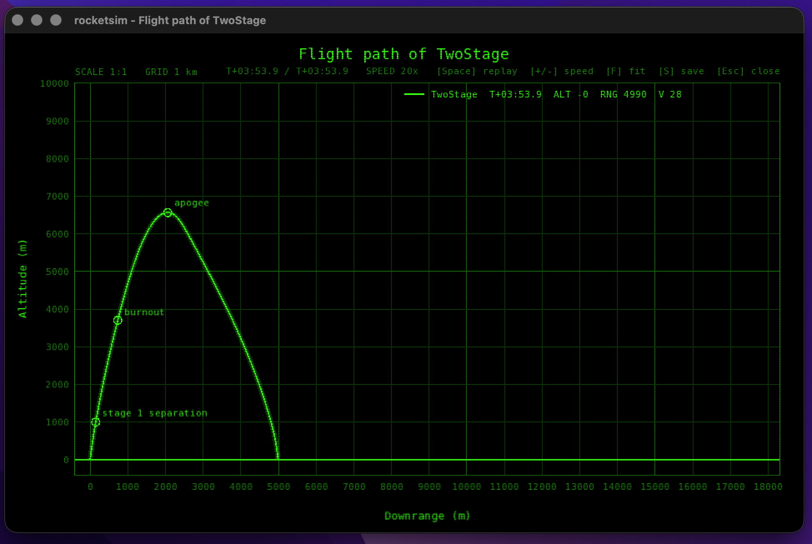
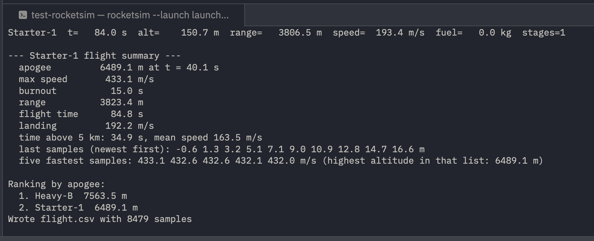
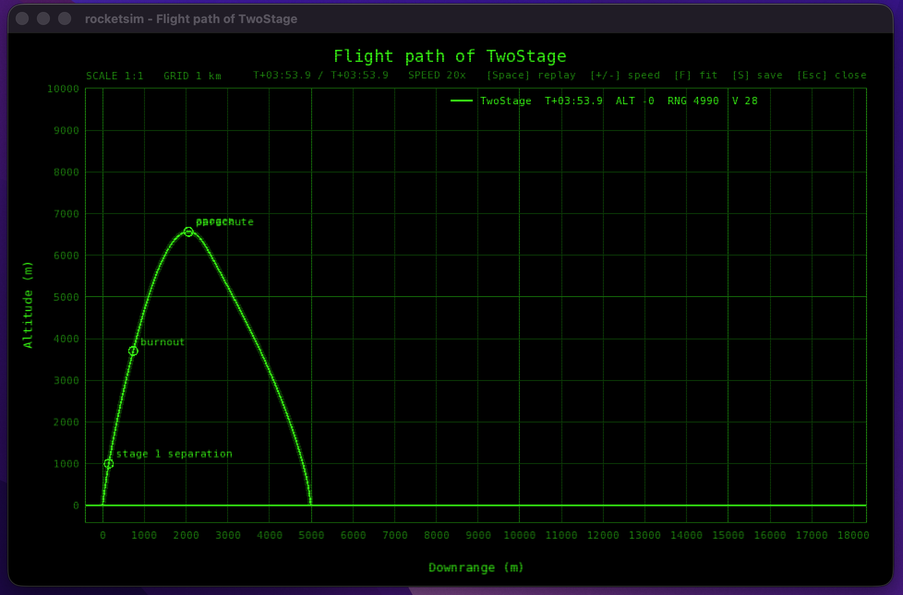

# Week 9 — Collections

### `vector`, `map`, `<algorithm>` and lambdas

| | |
| --- | --- |
| **Lecture material** | `std::vector` and the `size()` trap (A, 4–10) · range-based `for` and iterators (A, 14–18) · `vector<vector<>>` (A, 19–22) · `std::map` / `std::set` and `operator<` (B, 1–6) · `std::queue` / `std::deque` (B, 7–9) · `sort`, `max_element`, `count_if`, `accumulate`, `transform` (B, 10–16) · lambdas and `std::function` (B, 17–22) |
| **Starting point** | Week 8 Easy at least (operators and the `Rocket` class). The Week 8 Medium `TelemetryLog` class is what gets replaced — if you skipped it, start straight from `std::vector`. |
| **Files you will edit** | `simulation.h/.cpp`, `telemetry.h/.cpp`, `rocket.h/.cpp`, `physics.cpp`, `config.cpp`, `main.cpp` |
| **Reference pages** | [simulation](../code-reference/simulation.md) · [config](../code-reference/config.md) · [plot](../code-reference/plot.md) |

---

## By the end of this lab

- The hand-written `TelemetryLog` is **gone**, replaced by `std::vector<Sample>`.
- Every loop that searched the log is **one call** to `<algorithm>`.
- *(Medium)* The rocket can have **multiple stages**, the air has an **altitude-dependent wind**, and you can fly and **rank a fleet** of rockets.
- *(Hard)* Timed **events** fire during the flight, and a **parachute** slows the landing.

---

## Background

### The problem

Count the lines in your `TelemetryLog`: the `new[]`, the capacity doubling, the copy loop, the `delete[]`, the copy constructor, the copy assignment with its self-check. All of that exists to do one thing, **hold a growable list of samples**. And it is still easy to get wrong.

The standard library already solved this. `std::vector<T>` grows itself, copies itself correctly, and frees itself. Swapping it in is this week's payoff for last week's pain.

The same goes for loops. Finding the apogee by hand means a variable, a loop, a comparison and an update, four places to make a mistake. `std::max_element` with a **lambda** says *what* you want ("the sample with the largest `y`") and lets the library handle *how*.

### Algorithms + lambdas

A lambda is an unnamed function you write inline, exactly where it is needed. Algorithms take them as arguments to customise their behaviour:

```cpp
// A generic illustration with unrelated data.
std::vector<std::string> words = {"apple", "kiwi", "banana"};

auto longest = std::max_element(words.begin(), words.end(),
    [](const std::string& a, const std::string& b) { return a.size() < b.size(); });

std::cout << *longest << " at index " << (longest - words.begin()) << '\n';
```

Note that `max_element` returns an **iterator**, not a value. Dereference it with `*` to get the element, subtract `begin()` to get its index.

### Choosing a container

| Need | Container |
| --- | --- |
| An ordered list that grows at the end | `std::vector` |
| Fast lookup by key, kept sorted by key | `std::map` |
| "Is this in the set?" | `std::set` |
| Add at the back, remove from the front | `std::queue` / `std::deque` |

---

## Easy — replace the hand-written log

### Task E1 · Delete `TelemetryLog`

1. **Delete** the `TelemetryLog` class (keep `Sample`).
2. `simulate` now takes `std::vector<Sample>& log` and does `log.push_back(sample)`.
3. `writeCsv` takes `const std::vector<Sample>&` and uses a **range-based `for`**.
4. Count the lines of code you just removed. That is what Week 8's rule of three cost.

**Done when:** `telemetry.csv` is identical to last week's, and there is no `new` or `delete` left in the telemetry code.

---

### Task E2 · Statistics with `max_element`

Remove the apogee and max-speed tracking from inside the loop. Replace it with **two `std::max_element` calls after the loop**, each with a lambda comparing `y` or `speed`.

The apogee time comes from the same iterator, so `FlightStats` needs no bookkeeping inside the loop any more.

**Done when:** the summary numbers are unchanged and the loop body is shorter.

---

### Task E3 · `count_if` and `accumulate`

Using algorithms and lambdas, report:

| Quantity | Algorithm |
| --- | --- |
| Seconds spent above 5,000 m (`count × dt`) | `std::count_if` |
| Mean speed over the flight | `std::accumulate` |

**Done when:** both numbers appear in the summary and look plausible against the plot.

---

### Task E4 · The `size()` trap

1. Write a loop that prints the **last ten samples backwards**:
   ```cpp
   for (std::size_t i = log.size() - 1; /* … */)
   ```
   Watch it either **underflow** or need a cast. Think about what `i >= 0` means for an unsigned type.
2. Rewrite it with **reverse iterators** (`rbegin()`).
3. Keep **both** versions, the first one commented outs, as evidence.

**Done when:** the reverse-iterator version prints ten samples in descending time order.

---

## Medium — stages, a wind profile and a fleet

### Task M1 · Multi-stage rockets

Real rockets drop empty tanks so they stop carrying dead weight.

1. Add:
   ```cpp
   struct Stage { double dryMass, fuelMass, thrust, burnRate; };
   ```
   and give `Rocket` a `std::vector<Stage>`.
2. The **bottom stage burns first**. When its fuel is gone it is dropped, `erase` the front, or keep an index, and its dry mass goes with it.
3. Add a `stage 1 separation` **marker** on the plot.
4. `mass()` becomes `std::accumulate` over the remaining stages plus the payload.
5. Extend the launch-file parser to accept repeated lines:
   ```text
   stage = <dry> <fuel> <thrust> <burn>
   ```

**Done when:** a two-stage rocket with the **same total fuel** as `Starter-1` reaches a **higher apogee**.



---

### Task M2 · A wind profile

Wind usually gets stronger with altitude. Store wind speed (m/s, in +x) against altitude in a `std::map<double, double>`, initialised with a list:

```cpp
{{0, 2}, {1000, 8}, {5000, 20}, {15000, 35}}
```

Write:

```cpp
double windAt(const std::map<double, double>& profile, double altitude);
```

using `lower_bound` and **linear interpolation** between the two neighbouring entries. Feed the result into the drag calculation as the air velocity.

> [!IMPORTANT]
> Add a comment explaining why `operator[]` must **not** be used inside `windAt`. Look up what `operator[]` does when the key is missing.

**Done when:** `windAt` returns the table values exactly at the listed altitudes, sensible values in between, and the range changes with the wind on.

---

### Task M3 · A fleet

1. Read several launch files from the command line into a `std::map<std::string, Rocket>` keyed by name.
2. `Rocket` has no default constructor, so `fleet[name] = …` **will not compile**. Use `emplace` or `insert`.
3. Fly each rocket on the **same plot**.
4. Collect a `std::vector<std::pair<std::string, FlightStats>>`, `sort` it by apogee with a lambda, and print the **ranking**.

This is the word-frequency example from the lecture, with rockets instead of words.

**Done when:** two or three rockets appear on one plot and a ranking is printed from **one** `sort` call.



---

## Hard — scheduled events and a parachute

### Task H1 · An event queue

Define:

```cpp
struct Event {
    double time;
    std::string label;
    std::function<void(Rocket&)> action;
};
```

Read events into a `std::vector<Event>`, `sort` by time, and in the loop run (and remove) every event whose time has passed. Implement two examples:

| Time | Event |
| --- | --- |
| t = 20 s | Throttle to 50 % (needs the Week 8 `LiquidEngine`) |
| t = 30 s | Jettison the fairing: reduce dry mass by 5 kg |

The lambdas **capture what they need by value**.

**Done when:** both events fire at the right time and are marked on the plot.

---

### Task H2 · A parachute

Add a `deployParachute()` event triggered **not by time** but by the first step where vertical velocity turns negative (i.e. at apogee). It multiplies the drag area by **20** (a drogue chute) and marks the plot.

**Done when:** landing speed drops from about **190 m/s** to about **25 m/s**. Print it.

> [!NOTE]
> A 200× main canopy would land under 10 m/s, but takes over twelve minutes to come down. If you try it, raise `max_time` too.



---

### Task H3 · A table-driven parser

Replace the `if` / `else if` chain in `loadLaunchFile`:

- Validate keys with a `std::set<std::string>` of known keys report unknown ones using `set::count`.
- Dispatch with a `std::map<std::string, double*>` from each key to the field it sets, so the parser becomes a single loop.

**Done when:** `launch.txt` still reproduces the default flight, and a misspelt key is still reported with its line number.

---

### Task H4 · `transform` and `partial_sort`

1. Use `std::transform` to produce a `std::vector<double>` of altitudes from the log.
2. Use `std::partial_sort` to print the **five fastest samples** without sorting the whole log.

**Done when:** the five samples print in descending speed order.

---

## Checkpoint

Before moving on, run your program and check each of the following yourself:

| Tier | Check that… |
| --- | --- |
| Easy | The CSV is written from a `std::vector<Sample>`, and the apogee is found by `max_element`, **not** by the loop. |
| Medium | A two-stage rocket plot with a **separation marker**, and a console **ranking** of two or three rockets by apogee from one `sort` call. |
| Hard | A **parachute marker** near apogee and a landing speed of about **25 m/s**. |

---

## Watch out for

- **`max_element` returns an iterator.** Dereference it for the value, subtract `begin()` for the index.
- **`erase` at the front of a `vector`** is fine at this scale. A `deque` is the textbook answer, and worth knowing why.
- **`map::operator[]` default-constructs a missing value.** With a `Rocket` that has no default constructor this is a compile error which is the right outcome.
