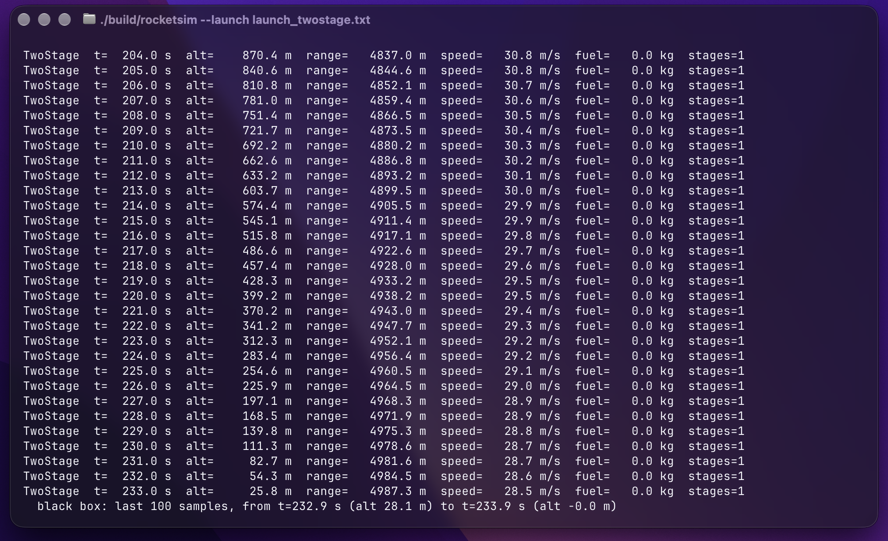
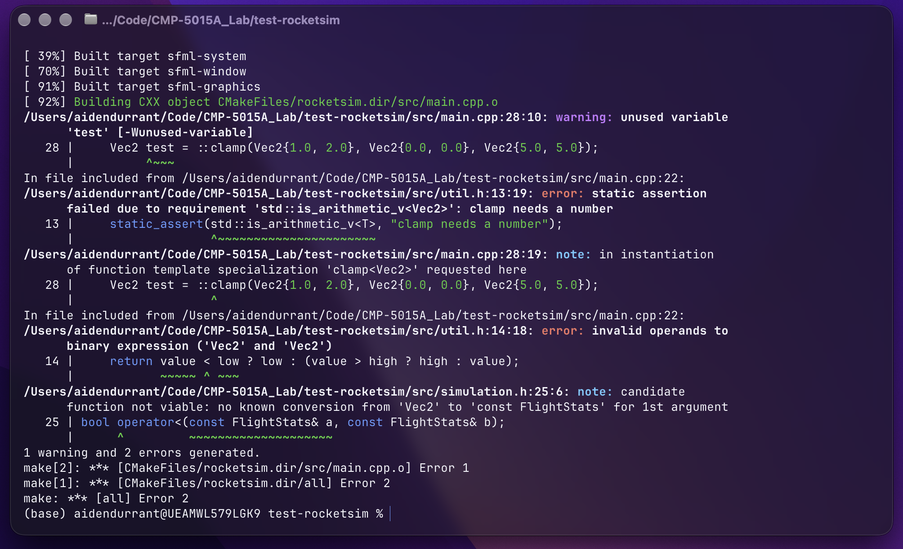
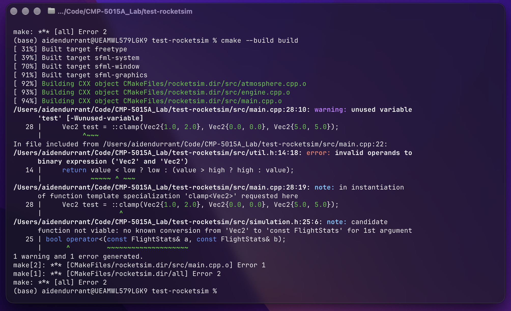

# Week 10 — Templates and lambdas

### Function templates, class templates and lambdas with captures

| | |
| --- | --- |
| **Lecture material** | Function templates and deduction (A, 5–10) · class templates and non-type parameters (A, 11–17) · `static_assert` (A, 18–20) · lambdas, capture lists and `std::function` (Week 9, B 17–22) |
| **Starting point** | Your Week 9 project, at least Easy and Medium M2 (the wind profile) and M3 (the fleet). If you are behind, copy the Week 9 model solution `src/` over your project first. |
| **Files you will edit** | `rocket_spec.h`, `rocket.h/.cpp`, `engine.h/.cpp`, `force.h/.cpp`, `simulation.h/.cpp`, `physics.cpp`, `wind.h`, `config.cpp`, `main.cpp`, `launch_twostage.txt`. New: `util.h`, `history.h`, `atmosphere.h/.cpp`, `mission_control.h`. Deleted in M2: `physics.h/.cpp`, `wind.h`. Each task starts with a table of the files it touches |
| **Reference pages** | [rocket](../code-reference/rocket.md) · [simulation](../code-reference/simulation.md) · [physics](../code-reference/physics.md) |

---

## By the end of this lab

- Code that was written twice, once for `double` and once for `Vec2`, is written **once** as a function template.
- The fleet is built by **one lambda** that captures what it needs.
- *(Medium)* A generic **black box recorder** class template keeps the last 100 samples of every flight, and one `Atmosphere` object uses your templates for density and wind.
- *(Hard)* Your templates **check their arguments** with `static_assert`, engines are built from a **table of lambdas**, and mission control counts the rockets still alive with a lambda.

---

## Background

### The problem

Look through your code for logic that is written more than once:

1. **Clamping.** The throttle must stay between 0 and 1, and the altitude in `physics::airDensity` must never go below 0. Each is a range check written by hand.
2. **Blending.** `windAt` in `wind.h` blends between two `double` values from the wind table. Placing a marker between two samples would blend between two `Vec2` positions. The arithmetic is identical, only the **type** differs.
3. **Building rockets.** The Week 9 fleet in `main` fills a map of specs and a map of settings for the default design, fills them again for each launch file, then builds a third map of engines and a fourth of rockets. Every rocket goes through the same steps.

**Templates** fix the first two. You write the logic once with a placeholder type `T`, and the compiler generates a version for each type you call it with. **Lambdas** fix the third. A small function written inside `main` can **capture** the local variables it needs, so the repeated block becomes one call.

### A generic template

```cpp
// A generic illustration, not one of this week's tasks.
template <typename T>
T largest(const T& a, const T& b)
{
    return (a < b) ? b : a;      // works for any T that has operator<
}

largest(3, 7);                                  // T = int
largest(std::string("x"), std::string("y"));    // T = std::string
```

The template compiles for any type that supports the operations it uses. Call it with a type that does not, and the error appears **inside** the template, often pages long. A `static_assert` (Hard) improves that.

### A lambda with captures

```cpp
// A generic illustration, not one of this week's tasks.
int total = 0;
const int bonus = 5;

auto addScore = [&total, bonus](int score) { total += score + bonus; };

addScore(10);    // total is now 15
addScore(20);    // total is now 40
```

| Capture | Meaning |
| --- | --- |
| `[bonus]` | A **copy** of `bonus`, taken when the lambda is created |
| `[&total]` | A **reference** to `total`, so the lambda can change it |
| `[=]` | Copy everything the body uses |
| `[&]` | Refer to everything the body uses |

Capture by value when the lambda may run later, after the variable has changed or gone. Capture by reference when the lambda must change the variable, and the variable outlives the lambda.

---

## Before you start: given code

This week's code holds some objects through two standard library **smart pointers**. They are not part of this week's lectures, so the code that uses them is given. All you need to know is:

| Type | What it is |
| --- | --- |
| `std::unique_ptr<T>` | A pointer that deletes its object automatically when the pointer goes out of scope. It cannot be copied |
| `std::make_unique<T>(…)` | Creates a `T` and returns a `std::unique_ptr<T>` to it |
| `std::shared_ptr<T>` | A pointer that can be copied. The object is deleted when the **last** copy goes. `use_count()` says how many copies exist |
| `std::make_shared<T>(…)` | Creates a `T` and returns a `std::shared_ptr<T>` to it |

Use them exactly like a raw pointer: `p->name()`, `*p`.

Make the changes in G1 and G2 before you start the tasks. Each step names the file, the Week 9 line to find, and what it becomes. The line numbers are those in the Week 9 model solution (`rocketsim-solutions/week09/src/`). If your own code is laid out differently, search for the quoted text instead.

### G1 · The rocket holds its engine

In Week 9, `main` kept a `std::map<std::string, LiquidEngine>` and passed each rocket an `Engine*` into that map. From now on the rocket holds its own engine. This takes twelve steps in three files.

**`rocket.h`**

| Step | Find (Week 9) | Change to |
| --- | --- | --- |
| 1 | Line 8, `#include <vector>` | Add a new line below it: `#include <memory>` |
| 2 | Line 18, `Rocket(const RocketSpec& spec, Engine* engine);` | `explicit Rocket(const RocketSpec& spec);` |
| 3 | The blank line after it (line 19) | Insert the five lines in the box below |
| 4 | Line 44, `static int liveCount();` | Delete the line. Nothing has used it since Week 9 |
| 5 | Line 60, `Engine* engine_;` | `std::unique_ptr<Engine> engine_;` |

The five lines for step 3 say that a rocket cannot be copied, that it can be moved, and that it has a destructor:

```cpp
    Rocket(const Rocket&) = delete;
    Rocket& operator=(const Rocket&) = delete;
    Rocket(Rocket&&) noexcept;
    Rocket& operator=(Rocket&&) noexcept;
    ~Rocket();
```

Leave line 13, `class Engine;`, and line 33, `Engine& engine() const { return *engine_; }`, as they are. `*engine_` works the same on a `unique_ptr`.

**`rocket.cpp`**

| Step | Find (Week 9) | Change to |
| --- | --- | --- |
| 6 | Line 12, `Rocket::Rocket(const RocketSpec& spec, Engine* engine)` | `Rocket::Rocket(const RocketSpec& spec)` |
| 7 | Line 19, `engine_(engine)` | `engine_(std::make_unique<LiquidEngine>())` |
| 8 | The blank line after the constructor's closing `}` (line 22) | Insert the three lines in the box below |
| 9 | Lines 63 to 66, the `Rocket::liveCount()` function | Delete all four lines |

The three lines for step 8:

```cpp
Rocket::~Rocket() = default;
Rocket::Rocket(Rocket&&) noexcept = default;
Rocket& Rocket::operator=(Rocket&&) noexcept = default;
```

> [!WARNING]
> These three lines must go in `rocket.cpp`, below `#include "engine.h"` (line 10), and **not** in `rocket.h`. `rocket.h` only knows that `Engine` exists, not what it contains, and the compiler needs the full `Engine` class to destroy one.

**`main.cpp`**

| Step | Find (Week 9) | Change to |
| --- | --- | --- |
| 10 | Line 65, `std::map<std::string, LiquidEngine> engines;` | Delete the line |
| 11 | Line 69, `engines.emplace(name, LiquidEngine{});` | Delete the line |
| 12 | Line 70, `fleet.emplace(name, Rocket(spec, &engines.at(name)));` | `fleet.emplace(name, Rocket(spec));` |

Every rocket still gets a `LiquidEngine`, as in Week 9, so the `--events` throttle still works. Hard task H2 lets the launch file choose. Task E3 rewrites the fleet code in `main` properly.

### G2 · `simulate` holds its forces

All four steps are in **`simulation.cpp`**.

| Step | Find (Week 9) | Change to |
| --- | --- | --- |
| 1 | Line 8, `#include <iostream>` | Add two new lines below it: `#include <memory>` and `#include <vector>` |
| 2 | Line 37, `Force* forces[3] = {new Gravity(), new Thrust(), new Drag(settings.wind)};` | The four lines in the box below |
| 3 | Line 63, `for (const Force* force : forces)` | `for (const auto& force : forces)` |
| 4 | Lines 97 to 100, the loop `for (Force* force : forces) { delete force; }` after the flight | Delete all four lines. The forces are now destroyed when `forces` goes out of scope |

The four lines for step 2:

```cpp
    std::vector<std::unique_ptr<Force>> forces;
    forces.push_back(std::make_unique<Gravity>());
    forces.push_back(std::make_unique<Thrust>());
    forces.push_back(std::make_unique<Drag>(settings.wind));
```

The body of the loop at step 3, `total += force->apply(rocket);`, does not change. It must be `const auto&`, because `auto` on its own would try to copy each `unique_ptr`, which is not allowed.

**Done when:** the program builds and the flights are unchanged from Week 9.

---

## Easy — function templates and a lambda

### Task E1 · `clamp`

| File | What you change |
| --- | --- |
| `util.h` (new) | Write the `clamp` template |
| `engine.cpp` | `LiquidEngine::setThrottle` calls `clamp` |
| `physics.cpp` | `physics::airDensity` calls `clamp` |
| `main.cpp` | The `--events` throttle value calls `clamp` |

Each `.cpp` file that calls `clamp` needs `#include "util.h"`.

In a new header `util.h`, write:

```cpp
template <typename T>
T clamp(T value, T low, T high);
```

It returns `low` if `value` is below it, `high` if `value` is above it, and `value` otherwise. Use it in **three** places:

| File | Function | Clamp | Replaces |
| --- | --- | --- | --- |
| `engine.cpp` | `LiquidEngine::setThrottle` | the throttle fraction, between 0 and 1 | the nested `? :` range check |
| `physics.cpp` | `physics::airDensity` | the altitude, between 0 and `1.0e9` | `if (altitude < 0.0) altitude = 0.0;` |
| `main.cpp` | `main`, the `--events` throttle event (Week 9 H1) | the 50 % throttle value, between 0 and 1 | `const double throttle = 0.5;` |

If you did not do Week 9 H1, skip the third row.

> [!NOTE]
> A template must be defined in a **header**, not a `.cpp` file. The compiler needs the whole definition at every call so that it can generate the version for that type.

**Done when:** all three places call your `clamp`, and the flights are unchanged.

---

### Task E2 · `lerp`

| File | What you change |
| --- | --- |
| `util.h` | Add the `lerp` template |
| `wind.h` | `windAt` calls `lerp` with `double` |
| `simulation.cpp` | `simulate` calls `lerp` with `Vec2` for the apogee marker |

`wind.h` and `simulation.cpp` need `#include "util.h"`.

Add a second template to `util.h`:

```cpp
template <typename T, typename U>
T lerp(const T& a, const T& b, U t);
```

It returns `a` when `t` is 0, `b` when `t` is 1, and a straight line blend in between. Use it **twice**:

1. **`wind.h`**, in `windAt`, with `double`. Replace the Week 9 hand-written line `lower->second + t * (upper->second - lower->second)` with a `lerp` call.
2. **`simulation.cpp`**, in `simulate`, with `Vec2`. Week 9 places the `apogee` marker exactly on the highest sample found by `max_element`, in the line `plot.addMarker(highest->x, highest->y, "apogee");` after the flight loop. Build a `Vec2` from that sample and one from the sample after it, and move the marker halfway between them.

> [!NOTE]
> The `Vec2` call only compiles because `Vec2` has `operator+`, `operator-` and `operator*` from Week 8. That is the point: a template works with any type that supports the operations it uses.

**Done when:** `lerp` is called with both `double` and `Vec2`, and the flights are unchanged.

---

### Task E3 · One lambda builds the fleet

| File | What you change |
| --- | --- |
| `main.cpp` | Everything in this task. Add `#include <memory>`. `#include <map>` is no longer needed |

The Week 9 fleet in `main` used four maps: `specs`, `settingsByName`, `engines` (gone since G1) and `fleet`. Replace them all with one vector that holds each rocket, through a `std::shared_ptr`, together with its settings:

```cpp
std::vector<std::pair<std::shared_ptr<Rocket>, SimSettings>> fleet;
```

Then:

1. Write a lambda `addRocket` that takes a `const RocketSpec&` and a `SimSettings`, applies `--quiet` to the settings, creates the rocket with `std::make_shared<Rocket>(spec)`, and adds the pair to `fleet`.
2. Call `addRocket` for the default rocket when there are no launch files, and once for each launch file that loads. These are the two places that used to fill `specs` and `settingsByName`.
3. Change the flight loop to `for (auto& [rocket, settings] : fleet)`, using `*rocket` and `rocket->name()`. The settings no longer need looking up by name, and the `--quiet` check has moved into the lambda.
4. The plot title uses `fleet.front().first->name()` in place of `fleet.begin()->first`.

**Done when:** every rocket is added through `addRocket`, and the ranking prints exactly as in Week 9.

> [!NOTE]
> A `std::map` kept the fleet in name order. The vector keeps the order of the command line, so the rockets now fly in that order, and the CSV holds the log of the last rocket on the command line. The ranking is sorted, so it does not change.

---

## Medium — class templates

### Task M1 · A black box recorder

| File | What you change |
| --- | --- |
| `history.h` (new) | Write the `History<T, N>` class template |
| `simulation.cpp` | `#include "history.h"`. In `simulate`, create the black box, push each sample, and print the line at touchdown |

Aircraft carry a recorder that keeps only the **last few minutes**. Build one as a class template in `history.h`:

```cpp
template <typename T, std::size_t N>
class History;
```

| Requirement | Detail |
| --- | --- |
| Storage | A ring buffer held in a `std::array<T, N>` |
| `push(const T&)` | Add a value, overwriting the **oldest** when full |
| `size()` | How many values are held, never more than `N` |
| `capacity()` | `N`, as a `static constexpr` function |
| `operator[]` | Indexed **oldest first** |
| `latest()` | The most recent value |

In **`simulation.cpp`**, declare a `History<Sample, 100>` near the top of `simulate`, and push every sample into it straight after `log.push_back(…)`. At touchdown, print one line saying how many samples the black box holds, and the time and altitude of its **first** and **last** sample.

**Done when:** each flight ends with a black box line covering the final second, with its last altitude at or just below zero.



---

### Task M2 · An atmosphere built on your templates

| File | What you change |
| --- | --- |
| `atmosphere.h` (new) | Declare the `Atmosphere` class |
| `atmosphere.cpp` (new) | Define its constructor, `density` and `windAt` |
| `force.h` | `#include "atmosphere.h"` in place of `"wind.h"`. `Drag` holds the atmosphere (given) |
| `force.cpp` | `#include "atmosphere.h"` in place of `"physics.h"`. `Gravity`, `Thrust` and `Drag` use `Atmosphere` |
| `simulation.h` | `#include "atmosphere.h"` in place of `"wind.h"`. `SimSettings` holds the atmosphere (given) |
| `simulation.cpp` | `Drag` is built from `settings.atmosphere` (given) |
| `main.cpp` | Create the shared atmosphere, pass it in `addRocket`, print `use_count()` |
| `physics.h`, `physics.cpp`, `wind.h` | Delete these files |

In Week 9 the air model is spread over three places: the constants and `airDensity` in `physics.h/.cpp`, the `windAt` function in `wind.h`, and the wind table in `SimSettings::wind`. Gather them into one class in new files `atmosphere.h/.cpp`:

| Member | Detail | Comes from |
| --- | --- | --- |
| Constants | `GRAVITY`, `SEA_LEVEL_DENSITY`, `SCALE_HEIGHT`, `PITCH_OVER_ALTITUDE` as `static constexpr double` | `physics.h` |
| The wind table | A `std::map<double, double>` from altitude to wind speed, defaulting to `{{0, 2}, {1000, 8}, {5000, 20}, {15000, 35}}` | `SimSettings::wind` |
| `density(double altitude)` | The density formula, with your E1 `clamp` | `physics::airDensity` |
| `windAt(double altitude)` | The `lower_bound` lookup, with your E2 `lerp` | `wind.h` |

In **`force.cpp`**, `Gravity::apply` uses `Atmosphere::GRAVITY` in place of `physics::GRAVITY`, and `Thrust::apply` uses `Atmosphere::PITCH_OVER_ALTITUDE` in place of `physics::PITCH_OVER_ALTITUDE`. Then delete `physics.h`, `physics.cpp` and `wind.h`, and reload CMake.

Every rocket and every `Drag` force should use the **same** atmosphere. That sharing is given:

```cpp
// simulation.h, in SimSettings, replacing WindProfile wind{…}
std::shared_ptr<Atmosphere> atmosphere = std::make_shared<Atmosphere>();

// force.h, Drag keeps a copy of the pointer, replacing const WindProfile& profile_
explicit Drag(std::shared_ptr<const Atmosphere> atmosphere);
std::shared_ptr<const Atmosphere> atmosphere_;

// force.cpp, inside Drag::apply
atmosphere_->windAt(rocket.position().y)      // was windAt(profile_, …)
atmosphere_->density(rocket.position().y)     // was physics::airDensity(…)

// simulation.cpp, replacing the G2 line
forces.push_back(std::make_unique<Drag>(settings.atmosphere));

// main.cpp, before the fleet is built
auto atmosphere = std::make_shared<Atmosphere>();
std::cout << "Atmosphere use_count before the fleet: " << atmosphere.use_count() << '\n';
```

In **`main.cpp`**, inside `addRocket`, set `settings.atmosphere = atmosphere;`, which means `atmosphere` must now be captured too. After the fleet is built, and again at the end of `main`, print `atmosphere.use_count()`.

**Done when:** the flights are unchanged, and `use_count()` prints 1 before the fleet, 1 plus the number of rockets after it, and 1 again at the end.

---

## Hard — `static_assert`, a table of lambdas and mission control

### Task H1 · Checking a template with `static_assert`

| File | What you change |
| --- | --- |
| `util.h` | Add a `static_assert` to `clamp`. Add `#include <type_traits>` |
| `history.h` | Add a `static_assert` on `N` inside `History` (needs M1) |
| `main.cpp` | Temporary test lines for steps 3 to 6, at the top of `main`. Comment them out in step 7. Add `#include "history.h"` for step 6 |

A `static_assert` is checked by the compiler when the template is generated for a particular type or value. If its condition is `false`, compilation stops with your message.

1. In **`util.h`**, add this as the first line of `clamp`:
   ```cpp
   static_assert(std::is_arithmetic_v<T>, "clamp needs a number");
   ```
   `std::is_arithmetic_v<T>` is `true` for number types such as `int` and `double`, and `false` for everything else.
2. In **`history.h`**, add this inside `History`, above `public:`:
   ```cpp
   static_assert(N > 0, "History needs room for at least one value");
   ```
Now trigger each assert on purpose. Steps 3 to 6 all add test lines at the **very top** of `main` in **`main.cpp`**, straight after the opening `{`, and you build after each one. `main.cpp` already includes `util.h` (E1). Write `::clamp` with the two colons, which means "the `clamp` in no namespace", so the compiler uses yours and not `std::clamp` from `<algorithm>`.

3. **`clamp` on a `Vec2`, with the assert.** Add:
   ```cpp
   Vec2 test = ::clamp(Vec2{1.0, 2.0}, Vec2{0.0, 0.0}, Vec2{5.0, 5.0});
   ```
   Build. The first error is in `util.h`, on your `static_assert` line, and ends with **`clamp needs a number`**.
4. **`clamp` on a `Vec2`, without the assert.** In `util.h`, put `//` in front of the `static_assert` line, leave the test line from step 3 in `main.cpp`, and build again. Now the error is about `operator<` (*"invalid operands to binary expression"* or *"no match for operator<"*), and it points at the `return` line **inside** `clamp`, which is not where the mistake is.
5. **`clamp` on a `std::string`, without the assert.** Keep the `static_assert` commented out. Replace the step 3 line with:
   ```cpp
   std::cout << ::clamp(std::string("pear"), std::string("apple"), std::string("mango")) << '\n';
   ```
   Build and run. It compiles and prints `mango`. Then remove the `//` from the `static_assert` and build once more: the same line now fails with `clamp needs a number`.
6. **A `History` with no room.** Add `#include "history.h"` at the top of `main.cpp`, and replace the test line with:
   ```cpp
   History<double, 0> empty;
   ```
   Build. The error points at your `static_assert` in `history.h` and ends with **`History needs room for at least one value`**.
7. **Clean up.** Turn each test line in `main.cpp` into a comment, so the program builds and runs as before. Check that both `static_assert` lines are back in force, with no `//` in front.

**Done when:** both `static_assert`s are in place, the test lines in `main.cpp` are commented out, and the program builds and flies as before.





---

### Task H2 · An engine factory from a table of lambdas

| File | What you change |
| --- | --- |
| `rocket_spec.h` | Add `engineType` to `RocketSpec` |
| `config.cpp` | Add `"engine"` to `KNOWN_KEYS` and read the key in `loadLaunchFile` |
| `launch_twostage.txt` | Add `engine = liquid` |
| `engine.h` | Declare `makeEngine`. Add `#include <memory>` |
| `engine.cpp` | Define `makeEngine`. Add `#include <functional>`, `<map>` and `<stdexcept>` |
| `rocket.cpp` | The constructor calls `makeEngine` |
| `main.cpp` | Print the engine name as each rocket launches |

1. In **`rocket_spec.h`**, add `std::string engineType = "solid";` to `RocketSpec`. In **`config.cpp`**, add `"engine"` to the Week 9 `KNOWN_KEYS` set, and in `loadLaunchFile` store the value of an `engine` line in `spec.engineType`. In **`launch_twostage.txt`**, add the line `engine = liquid`.
2. Declare this in **`engine.h`** and define it in **`engine.cpp`**:
   ```cpp
   std::unique_ptr<Engine> makeEngine(const std::string& type);
   ```
   Inside it, keep a `std::map<std::string, std::function<std::unique_ptr<Engine>()>>` from each name to a lambda that builds that engine with `std::make_unique`. Look up the type and call the lambda. Throw `std::invalid_argument` for an unknown type.
3. In **`rocket.cpp`**, in the `Rocket` constructor, change the G1 line `engine_(std::make_unique<LiquidEngine>())` to `engine_(makeEngine(spec.engineType))`.
4. In **`main.cpp`**, change the Week 9 line `std::cout << "Launching " << name << "...\n";` so it also prints `rocket->engine().name()` in brackets.

Adding a new kind of engine now means adding **one line** to the table.

Rockets without an `engine` key now get a `SolidMotor`, which ignores the throttle. The `--events` throttle had no effect on the flights anyway, because every rocket burns out before 20 s.

**Done when:** a launch file with `engine = liquid` prints `(liquid engine)` as it launches, and one without the key prints `(solid motor)`.

---

### Task H3 · Mission control

| File | What you change |
| --- | --- |
| `mission_control.h` (new) | Copy in the given class below and write `alive()`. Add `#include <algorithm>`, `<memory>`, `<vector>` and `"rocket.h"` |
| `main.cpp` | `#include "mission_control.h"`. Create `control`, track each rocket in `addRocket`, print the counts |

Mission control **watches** the rockets without keeping them alive. The class and its storage are given. It holds `std::weak_ptr`, a pointer that does **not** keep its object alive. `expired()` is `true` once the object has been deleted.

```cpp
// mission_control.h
class MissionControl
{
public:
    void track(const std::shared_ptr<Rocket>& rocket) { tracked_.push_back(rocket); }
    int alive() const;                                   // you write this
    std::size_t tracked() const { return tracked_.size(); }

private:
    std::vector<std::weak_ptr<Rocket>> tracked_;
};
```

1. In **`mission_control.h`**, write `alive()` inside the class as **one** `std::count_if` call with a lambda.
2. In **`main.cpp`**, declare `MissionControl control;` before `addRocket`, and call `control.track(rocket)` inside `addRocket`. `control` must now be captured too.
3. In **`main.cpp`**, after the ranking, print `Mission control: <alive> of <tracked> rockets alive`. Then call `fleet.clear()` and print the alive count again.

**Done when:** with two launch files, mission control reports 2 of 2 rockets alive, then 0 after the fleet is cleared.

---

## Checkpoint

Before moving on, run your program and check each of the following yourself:

| Tier | Check that… |
| --- | --- |
| Easy | The flights are unchanged from Week 9 (Starter-1 lands about **3,820 m** downrange with the wind on). `clamp` is used in three places, `lerp` is called with **both** `double` and `Vec2`, and every rocket is added through **one** `addRocket` lambda. |
| Medium | A black box line at each touchdown, and `Atmosphere use_count` printing **1**, then **1 + number of rockets**, then **1**. |
| Hard | `engine = liquid` prints `(liquid engine)` as the rocket launches, and mission control reports **2 of 2** alive, then **0**. |

---

## Watch out for

- **Templates live entirely in headers.** A `History<T, N>` defined in a `.cpp` file gives "undefined reference" link errors that look like a build problem.
- **Mixed argument types stop deduction.** `clamp(x, 0, 1.0)` fails, because `T` cannot be both `int` and `double`. Write `0.0`.
- **`std::clamp` exists too.** With `<algorithm>` included, a call to `clamp` with standard library types may be ambiguous. Write `::clamp(…)` to be sure you are calling yours.
- **Capturing by reference in a lambda that runs later.** If the variable has gone by the time the lambda runs, the reference dangles. Event lambdas capture by value for this reason.
- **`for (auto force : forces)` does not compile** over the G2 vector, because it would copy each `unique_ptr`. Use `const auto&`.
</content>
</invoke>
